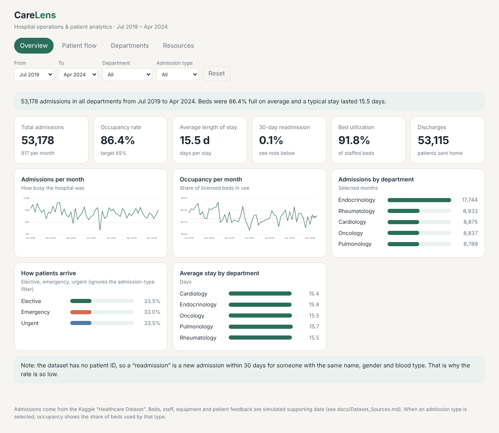

# CareLens – Hospital Operations & Patient Analytics

A small analytics project that turns hospital admission records into four dashboards:
**Overview, Patient Flow, Departments and Resource Utilization.**
I built it in four milestones (data → KPIs → dashboards → testing and delivery).



## What you can see
| Dashboard | Question it answers |
|---|---|
| Overview | How busy are we, how full are the beds, how long do patients stay? |
| Patient Flow | Which days are busiest, when is the peak load, how long are stays? |
| Departments | Which department performs best (efficiency score)? |
| Resource Utilization | Are beds, staff and equipment used well? Where is capacity tight? |

## Open it
- **Quick look:** download `dashboard/index.html` and open it in a browser (no install, works offline).
- **Tableau version:** build steps are in `docs/Tableau_Build_Guide.md`; the packaged workbook goes in `dashboard/tableau/CareLens.twbx`.

## Run it yourself
```bash
pip install pandas numpy openpyxl
cd scripts
python run_all.py
```
Or one step at a time:

| Step | Script | Creates |
|---|---|---|
| 0 | `make_supporting_data.py` | simulated resource, feedback and department files |
| 1 | `data_collection.py` | `data/hospital_raw_data.csv` |
| 2 | `clean_data.py` | `data/hospital_cleaned.csv` |
| 3 | `generate_hospital_kpis.py` | `data/hospital_final_dataset.xlsx` |
| 4 | `build_dashboard.py` | `dashboard/index.html` |
| 5 | `validate_kpis.py` | `docs/validation_output.txt` |

## Folder layout
```
data/        raw files, cleaned files, final Excel dataset
scripts/     the Python code (one file per step)
notebooks/   hospital_cleaning.ipynb – the cleaning step explained cell by cell
dashboard/   index.html, storyboard PDF, Tableau workbook
docs/        dataset sources, KPI definitions, methodology, user guide, QA
```

## Data
Admissions: Kaggle *Healthcare Dataset* (55,500 rows, synthetic). Beds, staff, equipment and
patient feedback are **simulated** by `make_supporting_data.py` because I couldn't find one public
file with all of them – details in `docs/Dataset_Sources.md`.

## Limits (honest list)
- No patient ID in the data, so readmissions are approximate (`docs/Methodology.md`).
- Admissions data is synthetic and very evenly spread, so departments look similar.
- Resource figures are simulated, not measured.

Author: Harsha · Tools: Python, pandas, Tableau Public, plain HTML/JS
