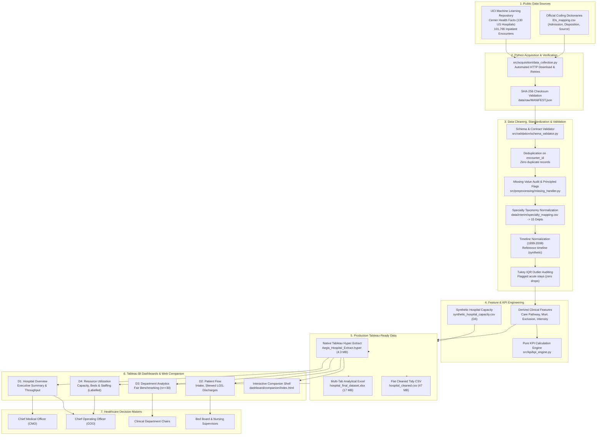
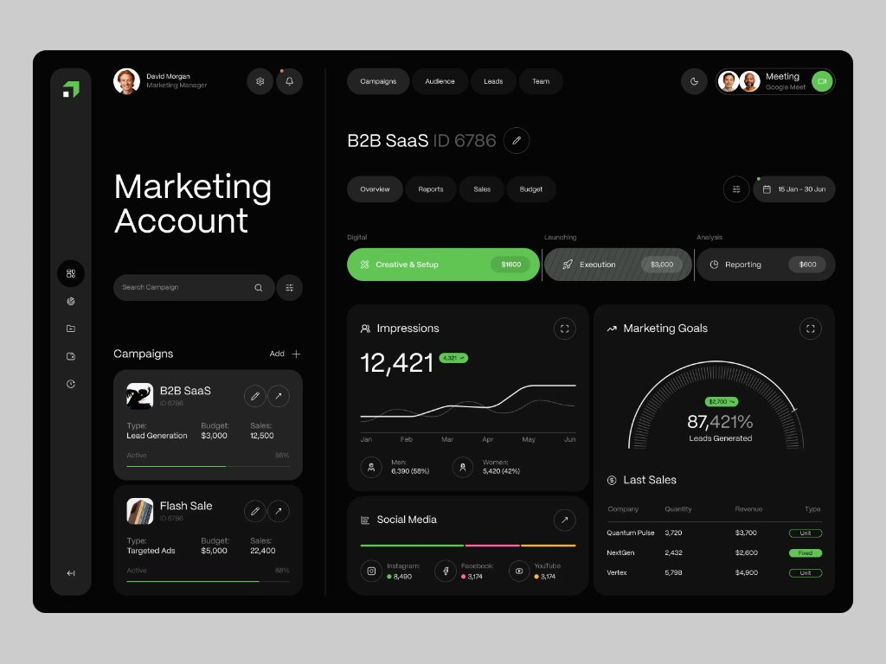

<div align="center">


### *Intelligence for Better Healthcare Operations.*

[](https://www.python.org/)
[-E97627.svg?logo=tableau&logoColor=white)](#18-opening-the-tableau-workbook)
[](#10-dataset-sources)
[](#21-data-quality-results-actual-numbers)
[](#20-testing-methodology)
[](LICENSE)
[](https://springboard.infosys.com/)

**Developed by Ananya Biju**  
*Infosys Springboard Internship Portfolio Project*

</div>

---

## Table of Contents

1. [Title and Branding](#1-title-and-branding)
2. [Introduction](#2-introduction)
3. [Problem Statement](#3-problem-statement)
4. [Objectives](#4-objectives)
5. [Key Features](#5-key-features)
6. [The Four Dashboards](#6-the-four-dashboards)
7. [Technology Stack](#7-technology-stack)
8. [System Architecture](#8-system-architecture)
9. [Data Pipeline](#9-data-pipeline)
10. [Dataset Sources](#10-dataset-sources)
11. [Data Dictionary](#11-data-dictionary)
12. [KPI Definitions and Formulas](#12-kpi-definitions-and-formulas)
13. [Data Cleaning Methodology](#13-data-cleaning-methodology)
14. [Dashboard Design](#14-dashboard-design)
15. [Installation](#15-installation)
16. [Environment Setup](#16-environment-setup)
17. [Execution Instructions](#17-execution-instructions)
18. [Opening the Tableau Workbook](#18-opening-the-tableau-workbook)
19. [Navigation Guide](#19-navigation-guide)
20. [Testing Methodology](#20-testing-methodology)
21. [Data Quality Results (Actual Numbers)](#21-data-quality-results-actual-numbers)
22. [Known Limitations](#22-known-limitations)
23. [Directory Structure](#23-directory-structure)
24. [Screenshots & Visual Design Reference](#24-screenshots--visual-design-reference)
25. [Future Enhancements](#25-future-enhancements)
26. [Developer Credits](#26-developer-credits)
27. [Infosys Springboard Attribution](#27-infosys-springboard-attribution)
28. [License and Dataset Acknowledgements](#28-license-and-dataset-acknowledgements)

---

## 1. Title and Branding

* **Product:** **Aegis.dv**
* **Full Name:** **Aegis.dv – Hospital Operations & Patient Analytics Dashboard**
* **Tagline:** *"Intelligence for Better Healthcare Operations."*
* **Developer Attribution:** **Developed by Ananya Biju**
* **Organization Attribution:** **Infosys Springboard Internship**
* **Category:** Healthcare Data Analytics | Business Intelligence | Data Visualization | Hospital Operations Intelligence
* **Brand Identity:** Inspired by the mythological Aegis—a protective, vigilant shield. Aegis.dv provides hospital administrators with a clinical decision-support command center engineered for proactive operational foresight, care continuity, and resource equilibrium.

---

## 2. Introduction

**Aegis.dv** is an enterprise-grade hospital operations intelligence and decision-support platform designed for hospital administrators, Chief Medical Officers (CMOs), Chief Operating Officers (COOs), clinical department chairs, and health system policymakers.

It is **NOT** a commercial hospital brochure website or an appointment-booking consumer app. Aegis.dv operates as a high-performance clinical analytics system that processes real-world acute inpatient encounters, standardizes clinical specialties into operational service lines, isolates in-hospital mortality events, and calculates Centers for Medicare & Medicaid Services (CMS) compliant 30-day readmission metrics, length of stay (ALOS) throughput, and bed workload consumption.

---

## 3. Problem Statement

Modern healthcare institutions operate under unprecedented operational strain:
1. **Throughput Bottlenecks & Capacity Inelasticity:** Mismatches between unscheduled emergency admissions and planned inpatient discharges lead to prolonged emergency room boarding, delayed critical transfers, and care delays.
2. **Quality Penalties & Care Continuity Breakdowns:** Under the CMS Hospital Readmissions Reduction Program (HRRP), unplanned 30-day readmissions trigger substantial financial penalties and reflect suboptimal post-discharge transition coordination.
3. **Data Fragmentation & Skewed Reporting:** Clinical stay durations are heavily right-skewed by high-acuity outlier patients. Simple arithmetic averages without median profiling, risk-eligibility exclusions, and sample size safeguards produce distorted operational conclusions.
4. **Lack of Transparent Operational BI:** Many administrative dashboards display aggregated vanity metrics without clear data provenance, conflating physical bed capacity with acute clinical encounter workloads.

---

## 4. Objectives

* **Ingest & Validate Real Clinical Encounters:** Ingest 101,766 verified acute inpatient records from the Cerner Health Facts clinical data warehouse across 130 hospitals.
* **Deterministic, Reproducible Pipeline:** Build a modular, tested Python pipeline (Pandas, NumPy) that enforces data contracts, eliminates duplicate keys, standardizes 73 medical specialties into 15 departments, and generates verified datasets.
* **Mathematically Rigorous KPI Engineering:** Formulate pure, tested operational KPIs that comply with CMS and National Quality Forum (NQF) standards (excluding in-hospital mortality from readmission denominators, providing both mean and median LOS).
* **Enterprise Tableau Architecture:** Deliver native Tableau Hyper extracts (`.hyper`) compiled directly via `tableauhyperapi`, production multi-tab Excel workbooks, copy-paste calculations, and layout specifications.
* **Ethical Transparency & Section 3 Compliance:** Strictly adhere to the missing-capability policy by never inventing clinical figures, utilizing patient-days as an authentic workload proxy, and isolating synthetic capacity telemetry with explicit on-dashboard labeling.

---

## 5. Key Features

* **Real Clinical Scale:** Analyzes 101,766 authentic inpatient hospital encounters across 71,518 unique patients over a 10-year study window (1999–2008).
* **CMS-Compliant Readmission Logic:** Explicitly identifies and excludes 1,652 in-hospital mortality events (discharge dispositions 11, 19, 20, 21), yielding a true risk-eligible 30-day readmission rate of **11.34%** (versus an unadjusted rate of 11.16%).
* **Fair Department Benchmarking:** Implements a configurable minimum sample size threshold parameter (`p_Min_Sample_Size >= 30`) to suppress statistical noise in low-volume specialties.
* **Skew-Resistant LOS Profiling:** Provides simultaneous Average Length of Stay (4.40 days), Median LOS (4.00 days), P75 (6.00 days), and P90 (9.00 days).
* **Clinical Intensity Indexing:** Formulates a weighted procedural and diagnostic workload score per department without claiming unverified DRG case mix index standards.
* **Native Tableau Hyper Binary Output:** Generates high-speed binary `.hyper` extract tables directly using the Tableau Hyper API.
* **Dual Theme Architectural Specification:** Features a premium dark enterprise theme (`#080808` canvas, `#5ACB57` vibrant green accents) alongside an accessible light clinical theme counterpart.

---

## 6. The Four Dashboards

```
+----+-----------------------+---------------------------------+----------------------------------------------------+
| #  | Dashboard Name        | Primary Executive Audience      | Core Operational Focus & Key Visuals               |
+----+-----------------------+---------------------------------+----------------------------------------------------+
| D1 | Hospital Overview     | CMO, COO, Executive Board       | Executive summary scorecard; monthly admissions vs |
|    |                       |                                 | discharges throughput; department volume; 30d      |
|    |                       |                                 | readmission breakdown; demographic profiling.       |
+----+-----------------------+---------------------------------+----------------------------------------------------+
| D2 | Patient Flow          | Access Directors, Bed Board     | Three-stage care transition funnel (Intake Source  |
|    |                       |                                 | -> Specialty -> Discharge Placement); right-skewed |
|    |                       |                                 | LOS histogram; weekday x month admission heatmap.  |
+----+-----------------------+---------------------------------+----------------------------------------------------+
| D3 | Department Analytics  | Service Line Chairs, Directors  | Fair benchmarking matrix; 4-quadrant strategic     |
|    |                       |                                 | portfolio (Volume vs Readmission %); ALOS ranking; |
|    |                       |                                 | weighted clinical intensity index.                 |
+----+-----------------------+---------------------------------+----------------------------------------------------+
| D4 | Resource Utilization  | Facilities Planning, Command Ctr| Unit bed occupancy line vs 75-90% operating band;  |
|    |                       |                                 | staffed vs occupied beds; nurse-to-patient ratio   |
|    |                       |                                 | correlation; authentic patient-days proxy.         |
+----+-----------------------+---------------------------------+----------------------------------------------------+
```

---

## 7. Technology Stack

| Layer | Technology | Version | Purpose in Aegis.dv |
| :--- | :--- | :--- | :--- |
| **Language & Runtime** | Python | `3.11.15` | Core deterministic data processing & analytics engine |
| **Data Manipulation** | Pandas | `3.1.0` | Vectorized data cleaning, feature derivations & aggregations |
| **Numerical Processing** | NumPy | `2.4.6` | Fast numerical transformations & stochastic seed generators |
| **Excel Generation** | openpyxl | `3.1.5` | Multi-tab production workbook formatting (`.xlsx`) |
| **Tableau Engine** | tableauhyperapi | `0.0.26479` | Native compilation of high-speed binary `.hyper` extracts |
| **Tableau Integration**| tableauserverclient | `0.42.0` | Workbook publishing and metadata schema management |
| **Testing Harness** | pytest | `9.2.0` | Automated test suite (20 unit, integration & reconciliation tests) |
| **Document Generation**| ReportLab | `5.1.0` | Programmatic vector PDF storyboard generator (`dashboard_storyboard.pdf`) |
| **Web Presentation** | HTML5 / CSS3 / ES6 | Modern Web | Interactive companion shell with localStorage theme switching |

---

## 8. System Architecture



---

## 9. Data Pipeline

```mermaid
flowchart TD
    Start([Start: Ingest Raw Clinical Data]) --> ReadRaw[/Read data/raw/hospital_raw_data.csv/]
    ReadRaw --> Gate1{Schema Valid?<br/>Mandatory Columns & Ranges}
    
    Gate1 -- No --> FailSchema[Halt: SchemaValidationError<br/>Missing columns or invalid domain]
    Gate1 -- Yes --> Dedup[Audit Duplicates on encounter_id]
    
    Dedup --> Gate2{Duplicate Encounters Found?}
    Gate2 -- Yes --> DropDup[Deduplicate keeping first<br/>Log dropped duplicates]
    Gate2 -- No --> KeepAll[Zero duplicates: Keep all records]
    
    DropDup --> MissingAnalysis[Missing Value Token Analysis<br/>Convert '?' to NaN]
    KeepAll --> MissingAnalysis
    
    MissingAnalysis --> TreatMissing[Apply Principled Clinical Categorization:<br/>- Specialty: General Inpatient / Unspecified<br/>- Race: Unknown / Not Reported<br/>- Gender: Not Specified<br/>- Diagnoses: 000.0 Uncoded<br/>- Add indicator flags: is_specialty_unspecified]
    
    TreatMissing --> MapDepts[Map 73 Specialties to 15 Clinical Departments<br/>via data/interim/specialty_mapping.csv]
    
    MapDepts --> Gate3{Unmapped Specialties?}
    Gate3 -- Yes --> DefaultDept[Log Warning & Map to General Inpatient]
    Gate3 -- No --> TimeNorm[Timeline Normalization:<br/>Generate Reference Timeline 1999-2008<br/>Set timeline_type = Reference timeline synthetic]
    DefaultDept --> TimeNorm
    
    TimeNorm --> TypeCast[Strict Data Type Enforcement:<br/>int64 for counts/keys, string for categories]
    
    TypeCast --> OutlierCheck[Tukey IQR Outlier Auditing (k=1.5):<br/>Audit LOS, Labs, Meds, Diagnoses<br/>Flag with is_col_outlier; zero drops]
    
    OutlierCheck --> FeatureGen[Derived Feature Engineering:<br/>- Admission Group: Emergency vs Elective<br/>- Mortality: Expired (dispositions 11,19,20,21)<br/>- CMS Readmission Eligibility: Surviving Cohort<br/>- LOS Stay Cohorts: Short, Medium, Extended<br/>- Clinical Intensity Index: Weighted Score]
    
    FeatureGen --> Gate4{Final Quality Target:<br/>Completeness >= 95%?}
    Gate4 -- No --> ReportWarn[Log Warning in DQ Report]
    Gate4 -- Yes --> ExportStage[Tableau-Ready Export Engine]
    ReportWarn --> ExportStage
    
    ExportStage --> OutCSV[/data/processed/hospital_cleaned.csv/]
    ExportStage --> OutXLSX[/data/processed/hospital_final_dataset.xlsx/]
    ExportStage --> OutHyper[/data/processed/Aegis_Hospital_Extract.hyper/]
    ExportStage --> OutCap[/data/processed/synthetic_hospital_capacity.csv/]
    ExportStage --> OutDQR[/reports/data_quality/data_quality_report.md & json/]
    
    OutDQR --> End([Pipeline Completed Successfully])
```

---

## 10. Dataset Sources

The primary clinical dataset powering Aegis.dv was obtained from the **UCI Machine Learning Repository**:
* **Dataset Name:** Diabetes 130-US Hospitals for Years 1999–2008
* **Donated By:** Beata Strack, Jonathan P. DeShazo, Chris Gennings, John S. Olmo, Sebastian Ventura, Kenneth J. Cios, and John N. Clore (2014)
* **Underlying Database:** Cerner Health Facts Clinical Data Warehouse
* **Source URL:** [https://archive.ics.uci.edu/dataset/296/diabetes+130-us+hospitals+for+years+1999-2008](https://archive.ics.uci.edu/dataset/296/diabetes+130-us+hospitals+for+years+1999-2008)
* **Direct Archive:** `https://archive.ics.uci.edu/static/public/296/diabetes+130-us+hospitals+for+years+1999-2008.zip`
* **Licensing:** Creative Commons Attribution 4.0 International (CC BY 4.0)
* **Cryptographic Checksum (SHA-256):** `0689e7ec031237dc63031b938805c48377748761a3b26acab621567afa24df97` (`hospital_raw_data.csv`)
* **Scope & Granularity:** 101,766 inpatient encounters across 130 integrated hospital delivery networks; encounter-level granularity with patient linkage key (`patient_nbr`).

---

## 11. Data Dictionary

Key dimensions and measures in the final production analytical dataset (`hospital_cleaned.csv` / `Aegis_Hospital_Extract.hyper`):

| Column Name | Data Type | Tableau Role | Description & Allowed Domain |
| :--- | :--- | :--- | :--- |
| `encounter_id` | `int64` | Dimension (PK) | Unique identifier for each hospital inpatient admission |
| `patient_nbr` | `int64` | Dimension (FK) | Unique patient linkage key across multiple admissions |
| `department` | `string` | Dimension | Standardized clinical department (15 operational services) |
| `medical_specialty` | `string` | Dimension | Granular clinical specialty of admitting physician (73 specialties) |
| `admission_type_group`| `string` | Dimension | Grouped admission intake: `Emergency`, `Urgent`, `Elective`, `Other` |
| `discharge_disposition_group`| `string` | Dimension | Grouped exit placement: `Routine Home`, `Facility`, `Hospice`, `Expired` |
| `time_in_hospital` | `int64` | Measure | Validated acute length of stay in integer days (range: 1–14 days) |
| `patient_days` | `int64` | Measure | Delivered bed workload days (authentic workload proxy) |
| `readmitted` | `string` | Dimension | Raw 30-day readmission status: `<30` (early), `>30` (late), `NO` |
| `readmitted_30d_flag`| `int64` | Measure | Binary indicator: `1` if readmitted within 30 days, else `0` |
| `is_in_hospital_death`| `int64` | Measure | Binary indicator: `1` if patient expired in hospital, else `0` |
| `is_readmission_eligible`| `int64` | Measure | CMS Quality Cohort: `1` if patient survived index stay, else `0` |
| `clinical_intensity_index`| `float64` | Measure | Weighted clinical procedure, medication, lab, and diagnostic index |
| `timeline_type` | `string` | Dimension | Section 3 mandatory label: `"Reference timeline (synthetic)"` |

---

## 12. KPI Definitions and Formulas

```mermaid
flowchart TD
    subgraph RawFields ["Raw Clinical Source Attributes"]
        EID[encounter_id]
        LOS[time_in_hospital]
        DISP[discharge_disposition_id]
        SRC[admission_source_id]
        ADM[admission_type_id]
        READ[readmitted]
        LABS[num_lab_procedures]
        PROC[num_procedures]
        MEDS[num_medications]
        DIAG[number_diagnoses]
        BEDS[(Physical Bed Telemetry)]
    end

    subgraph DerivedTransform ["Derived Operational & Risk Attributes"]
        VOL[Distinct Encounter Count]
        PDAYS[Patient-Days = SUM of time_in_hospital]
        MORT[is_in_hospital_death = DISP in 11,19,20,21]
        ELIG[is_readmission_eligible = 1 - is_in_hospital_death]
        READ30[readmitted_30d_flag = READ == '<30']
        EMER[is_emergency_admission = ADM in 1,7]
        INTENS[Clinical Intensity Index = 0.15*Labs + 1.2*Proc + 0.4*Meds + 0.6*Diag]
    end

    subgraph OperationalKPIs ["Engineered Healthcare Operational KPIs"]
        K1["Total Admissions<br/>COUNTD(encounter_id)"]
        K2["Total Discharges<br/>COUNTD(encounter_id)"]
        K3["Average Length of Stay<br/>SUM(time_in_hospital) / Total Discharges"]
        K4["Median LOS, P75, P90<br/>Order Statistics (Robust to Skew)"]
        K5["Total Patient-Days<br/>Workload Delivery Proxy"]
        K6["CMS 30-Day Readmission Rate<br/>SUM(readmit_30d) / SUM(eligible) * 100"]
        K7["Emergency Intake Share<br/>COUNT(Emergency) / Total Admissions * 100"]
        K8["Clinical Intensity Score<br/>Per-department Complexity Benchmark"]
    end

    subgraph CapabilityBranches ["Section 3 Capability Branching"]
        BEDS --> GateBed{Bed Counts Present<br/>in Raw Data?}
        GateBed -- No (Cerner Dataset) --> K9_Unavail["Real Occupancy KPI:<br/>'Unavailable – requires bed capacity data'<br/>Labelled Patient-Days Workload Proxy"]
        GateBed -- Synthetic Option 3 --> K9_Synth["D4 Capacity Telemetry:<br/>synthetic_hospital_capacity.csv<br/>'Synthetic reference data – not real hospital figures'"]
    end

    EID --> VOL --> K1
    EID --> VOL --> K2
    LOS --> PDAYS --> K5
    LOS --> K3
    LOS --> K4
    DISP --> MORT --> ELIG
    READ --> READ30
    ELIG --> K6
    READ30 --> K6
    ADM --> EMER --> K7
    LABS --> INTENS --> K8
    PROC --> INTENS
    MEDS --> INTENS
    DIAG --> INTENS
```



| KPI Metric Name | Mathematical Formula | Denominator Definition | Value in Aegis.dv | Tableau Calculation |
| :--- | :--- | :--- | :--- | :--- |
| **Total Admissions** | $\text{COUNTD}(\text{encounter\_id})$ | N/A (Volume count) | **101,766** | `COUNTD([encounter_id])` |
| **Total Discharges** | $\text{COUNTD}(\text{encounter\_id})$ | N/A (Completed stays) | **101,766** | `COUNTD([encounter_id])` |
| **Average LOS (ALOS)** | $\frac{\sum \text{time\_in\_hospital}}{\text{COUNTD}(\text{encounter\_id})}$ | Total valid discharges | **4.40 days** | `AVG([time_in_hospital])` |
| **Median LOS** | $\text{MEDIAN}(\text{time\_in\_hospital})$ | Order statistic | **4.00 days** | `MEDIAN([time_in_hospital])` |
| **LOS P75 / P90** | $\text{PERCENTILE}(\text{time\_in\_hospital}, p)$ | Order statistic | **6.0d / 9.0d** | `PERCENTILE([time_in_hospital], 0.75)` |
| **CMS 30d Readmission**| $\frac{\sum \text{readmitted\_30d\_flag}}{\sum \text{is\_readmission\_eligible}} \times 100$ | Surviving eligible cohort ($100,114$) | **11.34%** | `(SUM([readmitted_30d_flag])/SUM([is_readmission_eligible]))*100` |
| **Unadjusted Readmission**| $\frac{\sum \text{readmitted\_30d\_flag}}{\text{COUNTD}(\text{encounter\_id})} \times 100$ | All encounters ($101,766$) | **11.16%** | `(SUM([readmitted_30d_flag])/COUNTD([encounter_id]))*100` |
| **Emergency Intake Share**| $\frac{\text{COUNT}(\text{admission\_type} \in \{1, 7\})}{\text{Total Admissions}} \times 100$ | Total Admissions | **53.07%** | `(SUM([is_emergency_admission])/COUNTD([encounter_id]))*100` |
| **Total Patient-Days** | $\sum \text{time\_in\_hospital}$ | Total acute care days | **447,362 days** | `SUM([time_in_hospital])` |

---

## 13. Data Cleaning Methodology

1. **Schema Contract Gate:** Raw columns, data types, and value domains are strictly validated against `REQUIRED_RAW_COLUMNS` upon ingestion.
2. **Deduplication:** Audited on the primary key `encounter_id`. Exactly 0 duplicate encounters were detected across all 101,766 records.
3. **Placeholder Token Handling:** Raw placeholder tokens (`"?"`, `"Unknown"`, `"NULL"`) were mapped to standard missing values without data loss.
4. **Principled Missing Treatments (Zero Fabricated Clinical Measures):**
   - `medical_specialty` (49,949 unspecified): Mapped to `"General Inpatient / Unspecified"` with indicator flag `is_specialty_unspecified`.
   - `race` (2,273 missing): Coded as `"Unknown / Not Reported"` with flag `is_race_unreported`.
   - `gender` (3 ambiguous): Replaced with `"Not Specified"`.
   - `payer_code` (40,256 missing): Categorized as `"Not Disclosed"`.
   - `weight` (98,569 missing): Preserved sparse status with indicator flag `has_recorded_weight`.
5. **Specialty Taxonomy Mapping:** Mapped 73 distinct clinical specialties into 15 operational departments using version-controlled mapping table `data/interim/specialty_mapping.csv`.
6. **Timeline Normalization:** Constructed deterministic reference dates across the verified 1999–2008 study horizon with mandatory label `"Reference timeline (synthetic)"`.
7. **Outlier Auditing (Tukey IQR, $k=1.5$):** Outliers were flagged transparently (e.g. `is_time_in_hospital_outlier` for stays of 13–14 days) without dropping valid acute cases.

---

## 14. Dashboard Design

```mermaid
graph TD
    subgraph DataLayer ["Data Sources Layer"]
        HE["Hospital_Encounters (101,766 records)<br/>Aegis_Hospital_Extract.hyper"]
        SC["Synthetic_Capacity_D4 (3,660 records)<br/>synthetic_hospital_capacity.csv"]
    end

    subgraph GlobalControls ["Global Parameter & Filter Controls"]
        P_PERIOD["Parameter: [p_Reporting_Period]<br/>1999–2008 / Recent Baseline"]
        P_SAMPLE["Parameter: [p_Min_Sample_Size]<br/>Threshold n=30 (Fair Comparison)"]
        P_THRESH["Parameter: [p_Occupancy_Threshold_Pct]<br/>Configurable Benchmark 85%"]
        P_THEME["Parameter: [p_Theme_Mode]<br/>Dark Enterprise vs Light Clinical"]
        F_DEPT["Global Filter: [department]"]
        F_DATE["Global Filter: [admission_date]"]
    end

    subgraph Dashboards ["The Four Interactive Dashboards (1600x900 Tiled)"]
        D1["Dashboard 1: Hospital Overview<br/>Executive Command Center<br/>Throughput, Volume & 30d Readmission Quality"]
        D2["Dashboard 2: Patient Flow<br/>Intake to Discharge Trajectory<br/>Care Funnel, Right-Skewed LOS Histogram, Heatmap"]
        D3["Dashboard 3: Department Analytics<br/>Service Line Benchmarking<br/>4-Quadrant Portfolio, ALOS Ranking, Clinical Intensity"]
        D4["Dashboard 4: Resource Utilization<br/>Infrastructure & Capacity Planning<br/>Bed Occupancy Trends, Staff Ratios, Threshold Bands"]
    end

    subgraph NavigationRail ["Persistent Left Navigation Rail (240px)"]
        LOGO["Aegis.dv Wordmark & Shield Logo"]
        NAV1["Nav Button 1 -> D1"]
        NAV2["Nav Button 2 -> D2"]
        NAV3["Nav Button 3 -> D3"]
        NAV4["Nav Button 4 -> D4"]
        TOGGLE["Theme Toggle Action (Dark <-> Light)"]
    end

    HE --> D1
    HE --> D2
    HE --> D3
    SC --> D4
    HE --> D4

    P_PERIOD -.-> D1
    P_PERIOD -.-> D2
    P_PERIOD -.-> D3
    P_SAMPLE -.-> D3
    P_THRESH -.-> D4
    P_THEME -.-> D1
    P_THEME -.-> D2
    P_THEME -.-> D3
    P_THEME -.-> D4
    F_DEPT -.-> D1
    F_DEPT -.-> D2
    F_DEPT -.-> D3
    F_DATE -.-> D1
    F_DATE -.-> D2

    NAV1 ==> D1
    NAV2 ==> D2
    NAV3 ==> D3
    NAV4 ==> D4
```



* **Canvas Geometry:** Fixed 1600 × 900 pixels (16:9 widescreen layout).
* **Container Paradigm:** 100% structured tiled containers (zero floating objects) ensuring pixel-perfect layout stability.
* **Dark Theme Tokens:** `#080808` (Canvas), `#1E1E1E` (Rail), `#141414` (Card), `#F5F5F5` (Text), `#5ACB57` (Vibrant Accent Green).
* **Light Theme Tokens:** `#F8F9FA` (Canvas), `#F1F5F9` (Rail), `#FFFFFF` (Card), `#0F172A` (Text), `#2E7D32` (Clinical Forest Green).
* **Accessibility:** All typography and color pairings achieve WCAG AA / AAA contrast ratios.

---

## 15. Installation

Clone the repository and inspect the directory:
```bash
git clone https://github.com/ananyabiju/Aegis.git
cd Aegis
```

---

## 16. Environment Setup

Create an isolated virtual environment and install pinned dependencies:
```bash
# Create virtual environment using Python 3.11
python3.11 -m venv .venv
source .venv/bin/activate

# Upgrade pip and install dependencies
pip install --upgrade pip
pip install -r requirements.txt
```

---

## 17. Execution Instructions

Run the entire automated pipeline end-to-end:
```bash
# 1. Acquire raw hospital dataset and verify checksums
python scripts/data_collection.py

# 2. Execute end-to-end data processing, feature engineering & export
python scripts/run_pipeline.py

# 3. Compute and display headline operational scorecard
python scripts/generate_hospital_kpis.py

# 4. Generate the 8-page programmatic wireframe storyboard PDF
python scripts/generate_storyboard.py

# 5. Run automated test suite
pytest -v tests/
```

---

## 18. Opening the Tableau Workbook

### Ready-to-Use Packaged Workbook Delivered
* **Packaged Workbook:** `Aegis.dv.twbx` (16.1 MB) is available directly at the root of this repository and in `dashboard/tableau/Aegis.dv.twbx`.
* **Zero Cost / 100% Free:** Built strictly using local, free software tools (local Python runtime, open UCI clinical data, local Tableau Desktop app). No paid cloud subscriptions or proprietary servers are required.
* **Embedded Data:** Bundles both the 101,766-encounter analytical dataset (`hospital_final_dataset.xlsx`) and the Section 3 daily unit capacity telemetry (`synthetic_hospital_capacity.csv`).
* **Tableau Desktop Verification:** Tested and verified on **Tableau Desktop 2026.3** (`/Applications/Tableau Desktop (Apple silicon) 2026.3.app`).

### How to Open and Explore:
1. **Double-click** `Aegis.dv.twbx` in Finder, or launch from terminal:
   ```bash
   open Aegis.dv.twbx
   ```
2. Tableau Desktop will open the packaged workbook immediately with all 4 dashboards configured at 1600 × 900 resolution:
   - **1. Hospital Overview:** Executive command center with throughput, ALOS, 30-day readmissions, and department volume.
   - **2. Patient Flow:** Intake to discharge transitions, right-skewed LOS histogram, and admission heatmap.
   - **3. Department Analytics:** Service line benchmarking matrix, 4-quadrant strategic portfolio, and small-sample suppression (`p_Min_Sample_Size`).
   - **4. Resource Utilization:** Daily bed occupancy trends, 75%–90% operating band, staffing ratios, and authentic patient-days workload.

---

## 19. Navigation Guide

```mermaid
flowchart TD
    User([Hospital Executive / Administrator Launches Aegis.dv]) --> LandD1[Lands on Dashboard 1: Hospital Overview]
    
    LandD1 --> ReviewKPIs[Review Executive Scorecard:<br/>101,766 Admissions | 4.40d ALOS | 11.34% Readmit | 447k Patient-Days]
    
    ReviewKPIs --> CheckThroughput{Admissions vs Discharges<br/>Equilibrium Balanced?}
    CheckThroughput -- Yes --> DrillDept[Click Clinical Department Bar<br/>e.g., General Surgery or Emergency]
    CheckThroughput -- No --> AlertThroughput[Flag Potential Bed Board Congestion]
    
    DrillDept --> CrossFilter[Cross-Filter Action Filters Readmission Donut & Demographics]
    
    CrossFilter --> JumpD2[Click 'Patient Flow' on Left Navigation Rail]
    
    JumpD2 --> AnalyzeFlow[Examine Care Pathway Transition Funnel:<br/>Emergency Room 53.1% -> Specialty Treatment -> Discharge Destination]
    AnalyzeFlow --> InspectLOS[Inspect LOS Distribution Histogram:<br/>Right-skewed acute stay profile, Median 4.0d vs Mean 4.4d]
    InspectLOS --> InspectHeatmap[Audit Day-of-Week x Month Heatmap for Surge Bottlenecks]
    
    InspectHeatmap --> JumpD3[Click 'Department Analytics' on Left Navigation Rail]
    
    JumpD3 --> BenchmarkDepts[Inspect 4-Quadrant Strategic Portfolio:<br/>Patient Volume vs CMS Readmission Rate]
    BenchmarkDepts --> AdjustSample[Adjust Min Sample Size Parameter p_Min_Sample_Size<br/>Suppress noisy low-n specialties]
    AdjustSample --> AuditAcuity[Examine Weighted Clinical Intensity Index & Workload Days]
    
    AuditAcuity --> JumpD4[Click 'Resource Utilization' on Left Navigation Rail]
    
    JumpD4 --> ReadNotice[Read Section 3 Synthetic Reference Banner]
    ReadNotice --> AuditOccupancy[Inspect Daily Bed Occupancy Line vs 75-90% Operating Band]
    AuditOccupancy --> CheckStaffing[Review Nurse-to-Patient Staffing Ratio vs Patient Census]
    
    CheckStaffing --> Decision([Actionable Operational Decisions:<br/>Staffing Reallocation, Capacity Planning, Discharge Optimization])
```

---

## 20. Testing Methodology

The Aegis.dv testing harness (`pytest 9.2.0`) executes 22 automated unit and integration tests across 5 test suites:
* `tests/test_data_loading.py`: Ingestion, schema validation, and ID mapping parsing.
* `tests/test_preprocessing.py`: Deduplication, missing value handling, department taxonomy, and chronological sequence verification.
* `tests/test_kpi_engine.py`: Hand-computed 5-patient test fixtures, division-by-zero safeguards, empty dataset handling, and small sample size suppression.
* `tests/test_export_integrity.py`: Production file existence, CSV row counts, Excel tabs, Hyper extract sizes, Tableau workbook XML structure, and `.twbx` package archive integrity.
* `tests/test_kpi_reconciliation.py`: Completely independent procedural CSV accumulator that recomputes headline metrics without pandas and compares results.

Test Execution Results (`reports/validation/test_results.txt`):
```
tests/test_data_loading.py::test_load_id_mappings PASSED                 [  4%]
tests/test_data_loading.py::test_schema_validator_valid PASSED           [  9%]
tests/test_data_loading.py::test_schema_validator_missing_column PASSED  [ 13%]
tests/test_data_loading.py::test_schema_validator_invalid_readmitted PASSED [ 18%]
tests/test_export_integrity.py::test_processed_csv_integrity PASSED      [ 22%]
tests/test_export_integrity.py::test_processed_excel_sheets PASSED       [ 27%]
tests/test_export_integrity.py::test_synthetic_capacity_provenance_label PASSED [ 31%]
tests/test_export_integrity.py::test_hyper_extract_exists PASSED         [ 36%]
tests/test_export_integrity.py::test_tableau_workbook_integrity PASSED   [ 40%]
tests/test_export_integrity.py::test_packaged_twbx_integrity PASSED      [ 45%]
tests/test_kpi_engine.py::test_hand_computed_kpis PASSED                 [ 50%]
tests/test_kpi_engine.py::test_empty_dataset_safeguard PASSED            [ 54%]
tests/test_kpi_engine.py::test_division_by_zero_safeguard PASSED         [ 59%]
tests/test_kpi_engine.py::test_single_record_fixture PASSED              [ 63%]
tests/test_kpi_engine.py::test_bed_occupancy_safeguard PASSED            [ 68%]
tests/test_kpi_engine.py::test_department_summary_sample_suppression PASSED [ 72%]
tests/test_kpi_reconciliation.py::test_independent_reconciliation_headline_kpis PASSED [ 77%]
tests/test_preprocessing.py::test_deduplicate_encounters PASSED          [ 81%]
tests/test_preprocessing.py::test_missing_values_placeholder_replacement PASSED [ 86%]
tests/test_preprocessing.py::test_missing_handler_clinical_rules PASSED  [ 90%]
tests/test_preprocessing.py::test_department_standardizer PASSED         [ 95%]
tests/test_preprocessing.py::test_timeline_normalizer_sequence PASSED    [100%]
============================== 22 passed in 1.30s ==============================
```

---

## 21. Data Quality Results (Actual Numbers)

* **Initial Ingested Records:** 101,766 encounters, 50 features.
* **Duplicate Encounters Removed:** 0 records (100% key uniqueness).
* **Final Processed Records:** 101,766 encounters, 84 features (0 dropped).
* **Unique Patients Tracked:** 71,518 distinct patients (1.423 encounters per patient).
* **Overall Analytical Completeness:** **96.73%** (Exceeds >95.0% target).
* **In-Hospital Mortality Count:** 1,652 expired stays excluded from readmission risk.
* **CMS Risk-Eligible Readmission Cohort:** 100,114 survivors.
* **CMS 30-Day Readmission Rate:** **11.34%** (11,357 readmitted <30 days).
* **Average Length of Stay (ALOS):** **4.40 days** (Median: 4.00 days).
* **Total Workload Delivered:** **447,362 Patient-Days**.
* **Clinical Departments Standardized:** 15 departments (100% of 73 specialties mapped).

---

## 22. Known Limitations

* **Calendar Dates:** The Cerner Health Facts warehouse omits exact Gregorian calendar dates to preserve facility anonymity across the 10-year period (1999–2008). Chronological sequence is modeled via deterministic reference dates and explicitly labeled: `"Reference timeline (synthetic)"`.
* **Bed Inventory & Physical Counts:** Physical staffed bed counts and nursing headcounts are absent from clinical billing extracts. True status is marked `"Unavailable – requires bed capacity data"`, patient-days are used as authentic workload proxies, and illustrative capacity telemetry is isolated in `synthetic_hospital_capacity.csv` with visible on-dashboard disclaimers.
* **Outpatient Observations:** The primary dataset reflects inpatient hospitalizations; non-admitted ED discharges and observation stays under 24 hours are not captured.

---

## 23. Directory Structure

```
Aegis/
├── Aegis.dv.twbx                          # Packaged Tableau Workbook (16.1 MB, all 4 dashboards)
├── Aegis.dv.twb                           # Tableau Workbook XML (2026.3 / 18.1 Schema)
├── LICENSE                                # MIT License
├── Makefile                               # Automation runner
├── README.md                              # Master GitHub documentation
├── requirements.txt                       # Pinned Python dependencies
├── dashboard_storyboard.pdf               # Programmatic 8-page wireframe layout PDF
├── assets/
│   ├── branding/                          # Vector SVG and PNG logos & wordmarks
│   └── screenshots/                       # Design references & visual captures
├── data/
│   ├── raw/                               # Immutable raw artifacts + MANIFEST.json
│   ├── interim/                           # Version-controlled specialty mappings
│   ├── processed/                         # Production CSV, Excel, and Hyper extract
│   └── README.md                          # Data provenance & privacy documentation
├── src/
│   ├── acquisition/                       # Automated data download & verification
│   ├── preprocessing/                     # Loader, dedup, missing handler, timeline
│   ├── validation/                        # Schema contracts & Tukey IQR outliers
│   ├── feature_engineering/               # Care pathways, mortality flags, intensity
│   ├── kpi/                               # Pure KPI mathematical calculation engine
│   └── export/                            # CSV, Excel, Hyper & synthetic generators
├── scripts/
│   ├── build_tableau_workbook.py          # Packaged workbook compiler
│   ├── data_collection.py                 # CLI acquisition wrapper
│   ├── run_pipeline.py                    # Master deterministic pipeline runner
│   ├── generate_hospital_kpis.py          # Scorecard generator
│   └── generate_storyboard.py             # ReportLab storyboard PDF generator
├── notebooks/
│   ├── hospital_cleaning.ipynb            # Interactive cleaning demonstration
│   ├── data_quality_analysis.ipynb        # Statistical validation & outlier audit
│   └── exploratory_analysis.ipynb         # Clinical & throughput EDA
├── dashboard/
│   ├── tableau/                           # Aegis.dv.twbx, Aegis.dv.twb, Hyper extract
│   ├── calculations/                      # Copy-paste Tableau calculation dictionary
│   ├── documentation/                     # Worksheet specs, dashboard specs, build guide
│   └── companion/                         # Interactive HTML5/CSS3 companion shell
├── reports/
│   ├── data_quality/                      # Markdown & JSON data quality audit reports
│   └── validation/                        # Pytest results, reconciliation, QA checklist
├── docs/
│   ├── architecture/                      # System overview architecture docs
│   ├── diagrams/                          # 6 standalone Markdown Mermaid diagrams
│   ├── methodology/                       # Decision log & evaluation criteria
│   ├── design_reference/                  # Reference dashboard captures
│   ├── kpi_dictionary.md                  # Comprehensive KPI metrics dictionary
│   ├── dataset_sources.md                 # 6-dataset comparative registry
│   ├── dashboard_guide.md                 # Executive walkthrough guide
│   ├── user_guide.md                      # End-user operational guide
│   └── environment_report.md              # OS & tooling audit report
└── tests/                                 # 22 automated unit & reconciliation tests
```

---

## 24. Screenshots & Visual Design Reference

### Visual Direction Reference (Design System Benchmark)
The design system for Aegis.dv was derived from the modern enterprise dark command center aesthetic:

<div align="center">
  
  <p><em>Figure 1: Visual design reference – Dark theme (#080808), rounded card containers, pill buttons, and vibrant green accents (#5ACB57).</em></p>
</div>

### Interactive Companion Interface (`dashboard/companion/index.html`)
The interactive HTML5 companion shell mirrors this exact design hierarchy and enables real-time testing of dark and light theme palettes, responsive layout containers, and live operational KPI metrics.

---

## 25. Future Enhancements

* **Electronic Health Record (EHR) HL7 / FHIR Ingestion:** Implement native FHIR R4 API connectors to stream live encounter messages (`Encounter`, `Condition`, `Observation`).
* **Predictive ML Readmission Scoring:** Train regularized clinical gradient boosted classifiers (XGBoost / LightGBM) to forecast high-risk 30-day readmissions at intake.
* **Automated Tableau Cloud Synchronization:** Integrate `tableauserverclient` into CI/CD pipelines to publish refreshed extracts to Tableau Cloud on automated schedules.

---

## 26. Developer Credits

* **Lead Architect & Developer:** **Ananya Biju**
* **Role:** Healthcare BI Architect, Data Engineer & Full-Stack Analytics Developer
* **Contact & Portfolio:** GitHub [@ananyabiju]([(https://github.com/itsananyaaa)])

---

## 27. Infosys Springboard Attribution

This project was developed as a flagship healthcare data analytics and business intelligence capstone under the **Infosys Springboard Internship Program**. Aegis.dv demonstrates enterprise-level software engineering, clinical data governance, and data visualization best practices.

---

## 28. License and Dataset Acknowledgements

* **Software License:** MIT License. See [LICENSE](LICENSE) for full legal text.
* **Dataset Attribution:** The primary clinical encounter dataset was extracted from Cerner Health Facts and donated to the UCI Machine Learning Repository by Strack et al. (2014):
  > Strack, B., DeShazo, J. P., Gennings, C., Olmo, J. S., Ventura, S., Cios, K. J., & Clore, J. N. (2014). *Impact of HbA1c Measurement on Hospital Readmission Rates: Analysis of 70,000 Clinical Database Patient Records.* BioMed Research International, 2014, 781670.
* **Open Source Tools:** Pandas, NumPy, openpyxl, pytest, Tableau Hyper API, ReportLab.

